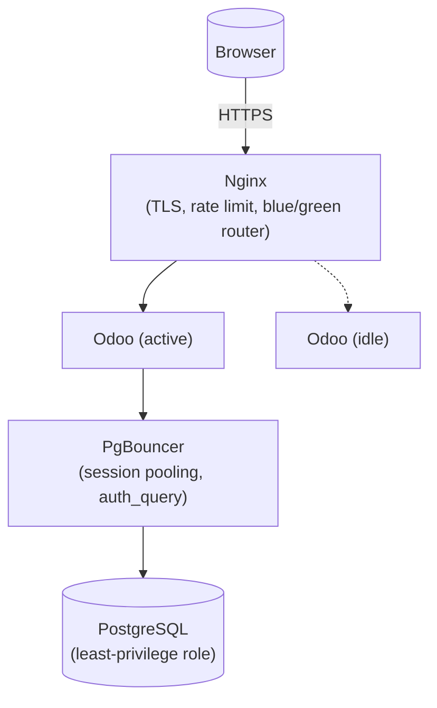
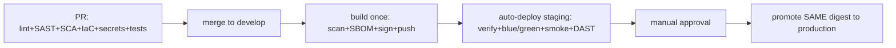

# Odoo DevSecOps Lab

A production-grade-*pattern* Odoo deployment lab: 3-tier architecture,
environment parity across dev/staging/production, Infrastructure as Code,
a security-gated CI/CD pipeline (build once → scan → sign → promote),
full observability, tested backup/DR, and a documented Kubernetes
extension. Built as a personal DevSecOps lab — every design decision is
recorded in [`docs/adr/`](docs/adr/) and every honest limitation is stated
in [`docs/ARCHITECTURE.md`](docs/ARCHITECTURE.md) rather than glossed over.

## Why this exists

Most "Odoo on Docker" examples online are a single `docker run` and a blog
post. This repo is the opposite exercise: what does deploying Odoo look like
when you actually apply DevSecOps practice end to end — network
segmentation, least privilege, supply-chain signing, policy-as-code, tested
disaster recovery, real observability — to a real (if modest) application?

## Architecture at a glance



Full diagrams and layer-by-layer breakdown: [`docs/ARCHITECTURE.md`](docs/ARCHITECTURE.md).

## Tech stack

| Layer            | Technology |
|-------------------|--------------|
| Reverse proxy     | Nginx (TLS 1.2/1.3, HSTS, rate limiting, blue/green routing) |
| Application       | Odoo 18.0, custom addon with unit tests |
| Database          | PostgreSQL 16 + PgBouncer (session pooling, `auth_query`) |
| IaC               | Terraform (Docker networks/volumes + optional Cloudflare/AWS/Hetzner modules) |
| Config management | Ansible (Linux hardening baseline) |
| CI/CD             | GitHub Actions (build once, promote strategy) |
| Container security| Trivy, Grype, Syft (SBOM), cosign (signing), Hadolint |
| SAST/SCA/Secrets  | Semgrep, pip-audit, Gitleaks, Dependabot |
| IaC security      | Checkov, TFLint, Conftest/OPA (policy-as-code) |
| DAST              | OWASP ZAP baseline |
| Secrets           | SOPS + age (see [ADR-0003](docs/adr/0003-sops-age-for-secrets-management.md)) |
| Observability     | Prometheus, Grafana, Alertmanager, Loki, Promtail, Tempo, OpenTelemetry |
| Backup/DR         | restic (encrypted, versioned, 3-2-1), tested restore drills |
| Load/DAST testing | k6, OWASP ZAP |
| Bonus             | Kubernetes (Helm + Argo CD + NetworkPolicy) — [`k8s/`](k8s/README.md) |

## Repository layout

```
.
├── addons/custom/        Custom Odoo addon (baked into the image, tested in CI)
├── ansible/               Linux host hardening (SSH, UFW, fail2ban, auditd...)
├── compose/               Docker Compose: base + per-environment overlays + monitoring
├── docker/                Dockerfiles + configs for odoo/nginx/postgres/pgbouncer
├── docs/                  Architecture, ADRs, threat model, runbooks, compliance
├── envs/                  Per-environment .env examples (real ones are SOPS-encrypted)
├── k8s/                   Kubernetes bonus track (Helm chart, Argo CD, policies)
├── monitoring/             Prometheus/Grafana/Alertmanager/Loki/Tempo configs
├── policy/opa/            Policy-as-Code (Conftest/OPA) for Terraform/Compose/Dockerfiles
├── scripts/                Backup, deploy (blue/green), security, TLS, chaos-drill scripts
├── secrets/                SOPS configuration + secrets workflow docs
├── terraform/              Networks/volumes (always-on) + optional cloud modules
├── tests/                  Integration (black-box), load (k6), DAST (ZAP) config
└── Makefile                Single entry point for every operation above
```

## Quickstart (local dev)

Requirements: Docker Engine + Compose plugin, Terraform ≥ 1.8, `make`.

```bash
git clone <this-repo> && cd odoo-devsecops-lab

# 1. Configure the dev environment
cp envs/dev.env.example envs/dev.env    # edit if you want, defaults work

# 2. Provision the Docker networks/volumes for "dev"
make plan ENV=dev
make apply ENV=dev

# 3. Issue a local self-signed certificate
./scripts/tls/issue_cert.sh dev

# 4. Bring the stack up
make build ENV=dev
make up ENV=dev

# 5. (optional) full observability stack too
make up-full ENV=dev
```

Odoo: https://localhost (accept the self-signed cert warning) · Grafana:
http://localhost:3000 (admin / value of `GRAFANA_ADMIN_PASSWORD`) · MailHog:
`docker compose --profile mail up -d mailhog` then http://localhost:8025.

`make help` lists every available target (deploy, backup, restore, chaos
drills, security scans, tests...).

## Environments

`dev`, `staging`, and `production` run the **exact same topology**
(environment parity — see [ADR-0002](docs/adr/0002-docker-compose-over-kubernetes-for-mvp.md)),
differing only in resource sizing, TLS certificate source (self-signed vs.
Let's Encrypt), and a few Odoo runtime flags. Each has fully isolated
networks, volumes, and secrets — see [`envs/README.md`](envs/README.md).

## CI/CD pipeline



Full sequence diagram: [`docs/diagrams/cicd-pipeline.mmd`](docs/diagrams/cicd-pipeline.mmd).
Design rationale: [ADR-0004](docs/adr/0004-build-once-promote-strategy.md)
(build once, promote) and [ADR-0005](docs/adr/0005-blue-green-deployment.md)
(blue/green).

## Security

- **Network:** 3 segmented Docker networks; the database tier has
  `internal: true` — no route to the Internet exists at the network layer,
  not just "no port published."
- **Supply chain:** every image is Trivy+Grype scanned, SBOM-attested, and
  cosign-signed before push; every deploy re-verifies the signature before
  pulling.
- **Secrets:** SOPS + age, never plaintext in Git — see
  [`secrets/README.md`](secrets/README.md).
- **Policy-as-Code:** Conftest/OPA gates in CI reject `:latest` tags, missing
  resource limits, root containers, and insecure Terraform resources before
  merge — see [`policy/opa/`](policy/opa/README.md).
- Full threat model (STRIDE): [`docs/THREAT_MODEL.md`](docs/THREAT_MODEL.md).
- Control → standard mapping (OWASP/CIS/NIST/ISO): [`docs/COMPLIANCE.md`](docs/COMPLIANCE.md).

## Observability

Prometheus + Grafana + Alertmanager (metrics/alerting), Loki + Promtail
(logs), Tempo + OpenTelemetry Collector (traces, integration point for
future app instrumentation). Four provisioned dashboards
(Infrastructure/Odoo/PostgreSQL/Security) ship out of the box —
`make up-full ENV=<env>`.

## Backup & Disaster Recovery

Daily encrypted, versioned, deduplicated backups via restic (Postgres
logical dumps + filestore archives), a **non-destructive** weekly restore
drill (`make test-restore`), and chaos-engineering scripts to rehearse
failure (`make chaos-db`, `make chaos-odoo`, `make chaos-disk`). RPO/RTO
targets and the full incident procedure: [`docs/runbooks/disaster-recovery.md`](docs/runbooks/disaster-recovery.md).

## Runbooks

[Deployment](docs/runbooks/deployment.md) ·
[Rollback](docs/runbooks/rollback.md) ·
[Backup & Restore](docs/runbooks/backup-restore.md) ·
[Disaster Recovery](docs/runbooks/disaster-recovery.md) ·
[Incident Response](docs/runbooks/incident-response.md) ·
[Troubleshooting](docs/runbooks/troubleshooting.md)

## Kubernetes (bonus track)

A Helm chart + Argo CD GitOps setup showing the same architecture on
Kubernetes (HPA, PodDisruptionBudget, NetworkPolicy, ExternalSecret). Not
the primary target — see [ADR-0002](docs/adr/0002-docker-compose-over-kubernetes-for-mvp.md)
for why — but fully documented in [`k8s/README.md`](k8s/README.md).

## Honest limitations

This is a personal lab, not an audited, certified production system. Stated
explicitly (not buried) in [`docs/ARCHITECTURE.md`](docs/ARCHITECTURE.md#known-limitations-stated-honestly-not-hidden)
and [`docs/THREAT_MODEL.md`](docs/THREAT_MODEL.md#known-gaps-tracked-not-hidden):
no MFA enforced by default, no WAF/DDoS scrubbing by default, disk-at-rest
encryption depends on the host, and PITR drilling is less mature than the
daily-backup restore path. Fixing any of these is a good next step, not a
secret to hide.

## Contributing

See [`CONTRIBUTING.md`](CONTRIBUTING.md) for the branch model, commit
convention, and PR checklist.

## License

[MIT](LICENSE).
