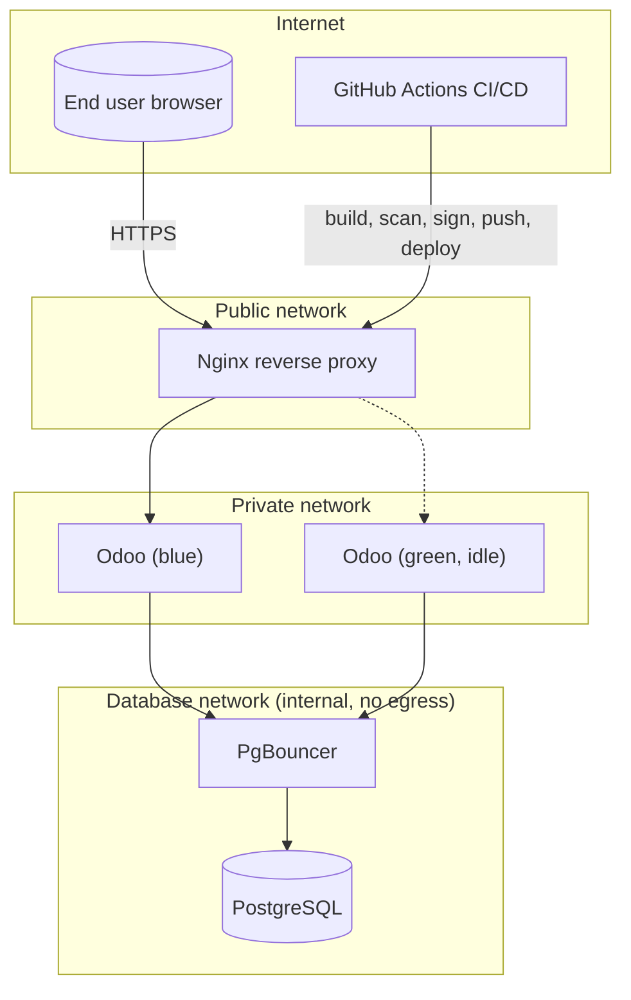

# Architecture

## Overview
A 3-tier Odoo deployment (reverse proxy → app → database), fully
containerized, replicated identically across dev/staging/production
(environment parity — see `docs/adr/0002`), provisioned via Terraform,
deployed via a blue/green pipeline with mandatory security gates, and
observed via a full Prometheus/Grafana/Loki/Tempo stack.

Full diagrams: [`docs/diagrams/architecture.mmd`](diagrams/architecture.mmd),
[`network.mmd`](diagrams/network.mmd),
[`cicd-pipeline.mmd`](diagrams/cicd-pipeline.mmd),
[`security-layers.mmd`](diagrams/security-layers.mmd).

## Layers, top to bottom

### 1. Network (Terraform, `terraform/modules/network`)
Three Docker networks with fixed subnets: `public`, `private`, `database`
(the last `internal: true` — no route to/from the Internet at all). See
`docs/security/hardening-checklist.md` for the exact CIDR map and every file
that must stay in sync with it.

### 2. Reverse proxy (Nginx, `docker/nginx/`)
TLS termination, HSTS + security headers, rate limiting (general + stricter
on `/web/login`), request-ID injection for log/trace correlation, and the
blue/green router (`/etc/nginx/active/active_upstream.conf`, rewritten and
hot-reloaded by `scripts/deploy/deploy.sh` — no rebuild needed to flip
traffic).

### 3. Application (Odoo, `docker/odoo/` + `addons/custom/`)
Multi-stage build, non-root, read-only root filesystem, resource-limited,
config rendered from a template at container start (never baked into the
image). Runs as a blue/green pair (`odoo-blue`/`odoo-green`) — see
`docs/adr/0005`.

### 4. Data (PostgreSQL + PgBouncer, `docker/postgres/` + `docker/pgbouncer/`)
Dedicated least-privilege role for the app (no superuser), a separate
`pg_monitor`-only role for metrics, `auth_query`-based PgBouncer
authentication (no static password file for application users), WAL
archiving for point-in-time recovery, hardened `pg_hba.conf` restricted to
the `database` subnet.

### 5. Infrastructure as Code (`terraform/`)
Always-on: Docker networks + volumes. Optional, disabled by default: DNS
(Cloudflare), object storage (AWS S3, for restic backups), compute (Hetzner
Cloud VPS) — see `docs/adr/0002` for why the Docker-only path is primary.

### 6. CI/CD (`.github/workflows/`)
Build once → scan (Trivy + Grype) → SBOM (Syft) → sign (cosign, keyless
OIDC) → push, then deploy the *exact same digest* to staging, then (after
manual approval) promote it unchanged to production. See `docs/adr/0004`.

### 7. Observability (`monitoring/`)
Metrics (Prometheus + exporters), logs (Loki + Promtail), traces (Tempo +
OpenTelemetry Collector — integration point for future app instrumentation),
dashboards + alerting (Grafana + Alertmanager). Odoo Community has no native
`/metrics` endpoint, so app-level health is measured via
`blackbox-exporter` synthetic HTTP probes rather than a scraped endpoint —
called out explicitly rather than glossed over.

### 8. Security tooling (cross-cutting)
SAST (Semgrep), SCA (pip-audit + Dependabot), secret scanning (Gitleaks),
IaC scanning (Checkov + TFLint + Trivy config), Policy-as-Code (OPA/Conftest,
`policy/opa/`), container scanning (Trivy + Grype), DAST (OWASP ZAP baseline
against staging), supply-chain signing (cosign) — see
`docs/security/hardening-checklist.md` for the full control mapping.

### 9. Kubernetes track (bonus, `k8s/`)
The same architecture re-expressed with Kubernetes primitives (HPA, PDB,
NetworkPolicy, ExternalSecret, Argo CD GitOps). Explicitly a documented
extension, not the primary target — see `docs/adr/0002`.

## Environment strategy
`dev`, `staging`, `production` share the exact same Compose topology
(`compose/docker-compose.base.yml`); only resource sizing, TLS certificate
source, and a handful of Odoo runtime flags differ per environment overlay.
Secrets, networks, and volumes are fully isolated per environment (separate
Terraform-managed resources, separate SOPS-encrypted env files, separate
Docker volumes) — nothing is shared across dev/staging/production.

## Data flow for a typical request
1. Browser → Nginx (TLS terminated, headers/rate-limit applied, request ID
   assigned).
2. Nginx → whichever Odoo color is currently active (`private` network).
3. Odoo → PgBouncer (`database` network) → PostgreSQL.
4. Response flows back the same path; Nginx access log + Odoo log both carry
   the same request ID for correlation in Loki/Grafana.

## Known limitations (stated honestly, not hidden)
See `docs/THREAT_MODEL.md`'s "Known gaps" section and `docs/COMPLIANCE.md`'s
per-standard notes for the full list — summarized: no MFA enforced by
default at the app layer, no WAF/DDoS scrubbing by default, disk-at-rest
encryption is host-dependent rather than enforced here, and WAL-based PITR
is implemented but less battle-tested via drills than the daily-backup
restore path. This lab optimizes for a small, honest, fully-working system
over a larger one with unverified claims.
